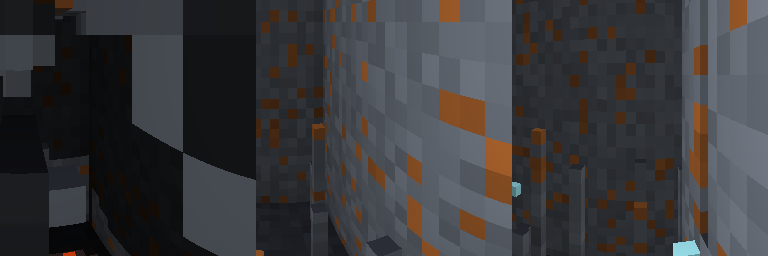

# tiny-marble

**Prompt-to-world 3D.** Type words, walk through the world they describe.

```python
from tiny_marble import dream_from_prompt
world = dream_from_prompt("a dark cavern with lava")
world.step(forward=1.0)
frame = world.render()  # 256x256 first-person RGB
```

Like World Labs' Marble, tiny: 32³ voxels, Taichi-accelerated rendering
(256×256 at 60-100 FPS with soft shadows, water reflections, ambient
occlusion), pure Python. Numpy fallback (64×64) if Taichi isn't installed.



## Install

```bash
pip install tiny-marble          # numpy renderer (64x64)
pip install tiny-marble[fast]    # + Taichi (256x256, 60-100 FPS)
```

## How it works

Text → attributes → voxels. The prompt is parsed into a small attribute
vocabulary (style, lava, water, dark, pillars), and the world is generated
conditioned on attributes. Phase 1 uses procedural generation; Phase 2 will
train a diffusion prior on attributes.

The renderer is a DDA raycaster with:
- Soft shadows (shadow rays toward lava pools)
- Water reflections (fresnel-blended)
- Voxel ambient occlusion
- Per-voxel texture noise
- Lava glow light grid

## Examples

```bash
python examples/prompt_demo.py "a dark cavern with lava"  # -> prompt_world.gif
python examples/showcase.py    # -> showcase.png (triptych)
python examples/walk4d_demo.py # -> walk4d.gif (explore + time reverse)
```

## License

Apache-2.0. Inspired by World Labs' Marble and InSpatio's 4D world architecture.
Original implementation, no code copied.
